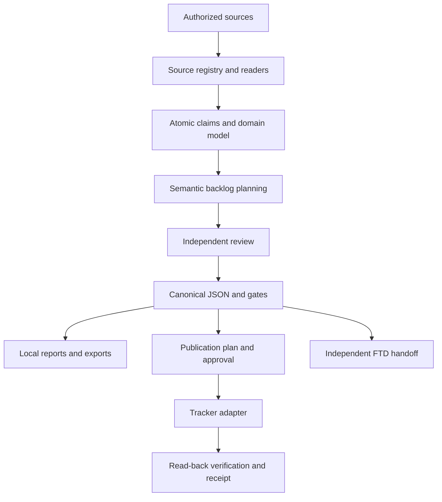

# Architecture

Single modular skill, agent-first, provider-neutral, local-first, domain- and tracker-agnostic. Agent performs semantic reasoning; deterministic runtime handles contracts, identities, state, conversions, validation and transport. No mandatory server, external database, model SDK or Docker.

## Components
| Module | Responsibility |
|---|---|
| Source Registry / Readers | inventory, hashes, versions, exact locators, coverage, scoped reading |
| Requirements Engine / Domain Modeler | atomic claims, actors, entities, states, rules, constraints |
| Hierarchy / Acceptance / Task Designers | meaningful capabilities, vertical stories, testable criteria, executable work |
| Dependency Engine | directed graph, cycle checks, confirmed vs proposed dependencies |
| Estimation Advisor / Sprint Planner | calibrated proposals, capacity, dates, uncertainty |
| Auditor / Comparator | every item and criterion, semantic differences, omissions, conflicts |
| Change Impact Analyzer | version deltas, ADR decisions, stable IDs, split/merge lineage |
| Traceability / Quality Gate Engine | forward and reverse evidence, deterministic plus semantic gates |
| Profile Engine / Convention Analyzer | approved writing conventions, process profiles, no error imitation |
| Schema Discovery / Field Mapping / Custom Field Adapter | discover actual types, fields, rules and permitted values |
| Field Provenance / Workflow Validator | proposed vs confirmed, state transitions, read-only fields |
| Rich Text Renderer / Backlog Simulator | safe HTML, preview of exact target fields and hierarchy |
| Artifact Renderer | offline HTML, Markdown, JSON, CSV, XLSX |
| Publication Engine / Human Change Protection | plan hash, revision checks, idempotency, checkpoint journal |
| Round-trip Validator | re-export and verify fields, hierarchy, formatting and deviations |
| Benchmark Engine | gold evidence, mutations, baselines and repeatability |

## Proposed stack
Python 3.11+, JSON Schema, Pydantic, pathlib/graphlib (NetworkX only if needed), HTTPX, Azure CLI/Azure Identity, Jinja2, BeautifulSoup and explicit sanitization, python-docx, openpyxl, PDF extraction with license-reviewed backend (PyMuPDF is optional subject to licensing), visual page inspection by agent, HTML/CSS/JS offline, Mermaid with safe local rendering, pytest, Hypothesis, Playwright, Ruff, mypy. GitHub Actions only when deliberately enabled; local qualification first.

## Canonical model
Versioned run manifest, sources, requirements, claims, work items, criteria, typed relations, questions, decisions, findings, metrics, field provenance, publication plan and receipt. IDs are opaque and stable across changes; tracker IDs are separate namespace. Every evidence link contains source ID/version/locator. Preserve unknown native fields and original HTML in raw snapshots; normalize separately. Hash manifests and artifacts; atomic writes and append-only journal. State transitions: draft → reviewed → gated → prepared → approved → applying → verified or partial/conflict. Approval invalidated by changes.

## Proposed layout
`src/pbd/{core,pipeline,sources,models,validation,audit,comparison,traceability,reporting,persistence,integrations}`; `schemas/`, `profiles/`, `entrypoints/`, `references/`, `templates/`, `tests/{unit,integration,contract,security,regression,e2e}`, `evals/`, `benchmarks/`. Create runtime modules only as implemented; do not pretend empty folders are features. M0 implements `core`, `persistence`, `sources`, `security`, `validation`, `integrations` (authorization boundary only) and bundles schemas under `src/pbd/schemas/v1/`; see [ADR-0001](decisions/ADR-0001-m0-foundation.md).

See [methodology](methodology.md), [quality gates](quality-gates.md), [Azure](azure.md), [roadmap](roadmap.md).
